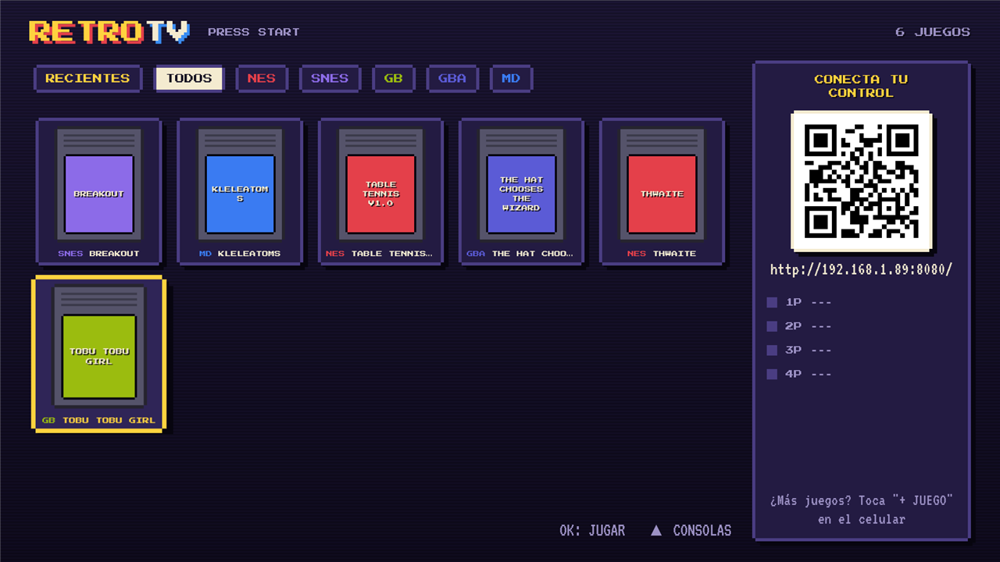
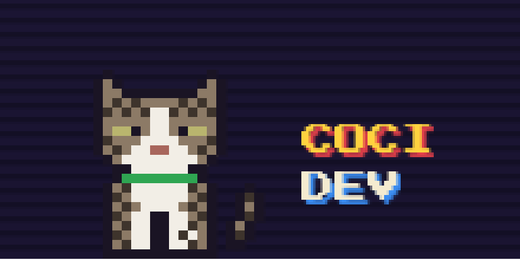
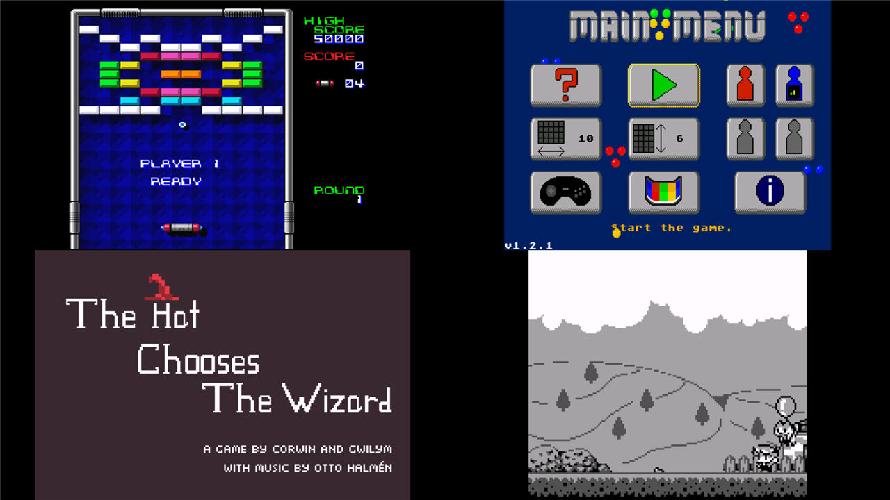
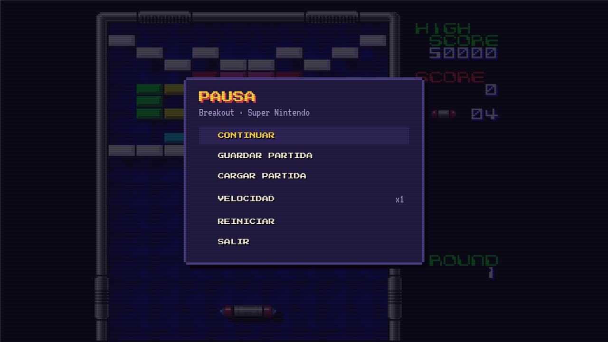
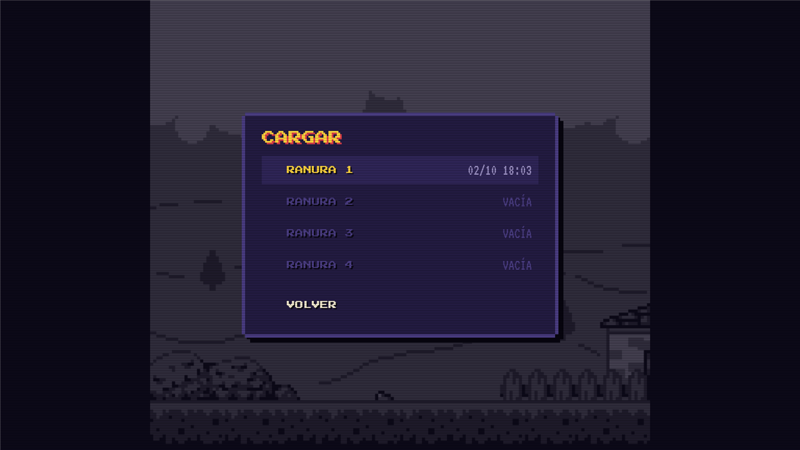
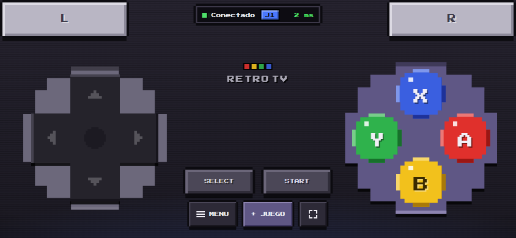
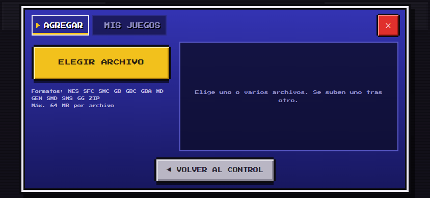

<div align="center">

# 🎮 RetroTV

**Una consola retro para tu Android TV, con el celular como control.**

Escaneas el QR de la TV, el celular se convierte en un control (sin instalar nada) y a jugar.
Hasta 4 jugadores con celulares o controles USB/Bluetooth.



[**⬇ Descargar APK**](https://github.com/coci-dev/retrotv/releases/latest/download/RetroTV.apk) ·
[Instalar](#-instalar-en-una-tv) ·
[Cómo se usa](#-cómo-se-usa) ·
[Cómo funciona](#-cómo-funciona)

</div>

---

## ✨ Qué hace

- **Consolas:** NES, Super Nintendo, Game Boy / Color, Game Boy Advance, Mega Drive / Genesis,
  Master System y Game Gear.
- **El celular es el control:** una página web con D-pad, A B X Y, L R, START y SELECT, con
  multitouch y vibración. No hay que instalar ninguna app en el celular.
- **Hasta 4 jugadores**, mezclando celulares y controles físicos (USB o Bluetooth).
- **Subes juegos desde el celular:** botón **+ JUEGO**, eliges el archivo y aparece en la TV.
  También se pueden borrar.
- **Biblioteca retro:** pestañas por consola, juegos recientes y carátulas que se descargan
  solas.
- **Menú de pausa:** 4 ranuras de guardado, avance rápido x2/x3, reiniciar.
- Y un gatito pixel art (Sonny) que te mira desde la esquina. 🐱

<p align="center">
  
</p>

## 📸 Capturas

| En la TV | |
|---|---|
|  |  |
| SNES, Mega Drive, GBA y Game Boy corriendo en la TV | Menú de pausa |
|  | |
| 4 ranuras de guardado por juego | |

| En el celular | |
|---|---|
|  |  |
| El control, estilo Super Famicom | Subir y borrar juegos |

## 📺 TVs compatibles

| Funciona ✅ | No funciona ❌ |
|---|---|
| Android TV / Google TV (Xiaomi, TCL, Sony, Philips, Hisense…) | Samsung (Tizen) |
| Chromecast con Google TV | LG (webOS) |
| TV Box Android, Fire TV de Amazon | Roku |

Requiere **Android 8 o superior**. Funciona en TVs de 32 y 64 bits.
En una TV Samsung o LG se puede usar conectándole un Chromecast con Google TV o una TV Box.

## ⬇ Instalar en una TV

### Opción 1: con la app Downloader (recomendada, sin cables)

1. En la TV, instala **Downloader** (de AFTVnews) desde la Play Store.
2. Ábrela y escribe esta dirección:
   ```
   https://github.com/coci-dev/retrotv/releases/latest/download/RetroTV.apk
   ```
3. Se descarga el APK y se abre el instalador.
4. La primera vez, la TV pide permitir que Downloader instale apps de **orígenes desconocidos**:
   acepta y vuelve a intentar.
5. Abre **RetroTV** desde las apps de la TV.

### Opción 2: con un pendrive

1. Descarga [`RetroTV.apk`](https://github.com/coci-dev/retrotv/releases/latest/download/RetroTV.apk)
   y cópialo a un pendrive.
2. Conéctalo a la TV y ábrelo con un explorador de archivos (**File Commander** o **X-plore**,
   ambos en la Play Store).

### Opción 3: por ADB desde un PC

En la TV: **Ajustes → Preferencias del dispositivo → Información → Compilación** (presiona OK
7 veces) y luego **Opciones para desarrolladores → Depuración USB** (funciona por Wi-Fi).

```powershell
adb connect <IP-de-la-TV>:5555     # acepta el aviso en la TV
adb install -r RetroTV.apk
```

### Actualizar

Instala la versión nueva encima, de la misma forma. Los juegos y las partidas se conservan.

## 🎮 Cómo se usa

### Conectar controles

- **Celular:** escanea el QR que aparece en la TV (el celular tiene que estar en la misma red
  Wi-Fi). Pon el celular en horizontal. El primero en conectarse es **1P**, el segundo **2P**, y
  así hasta 4.
- **Control USB o Bluetooth:** conéctalo a la TV (los Bluetooth se emparejan en
  *Ajustes → Controles remotos y accesorios*). Toma el siguiente puesto libre y aparece con su
  nombre en la TV.
- **Control remoto de la TV:** sirve para navegar y para jugar como 1P en juegos sencillos.

### Botones

| Acción | Celular | Control USB/Bluetooth | Control remoto |
|---|---|---|---|
| Jugar / aceptar | A | A (botón de la derecha) | OK |
| Menú de pausa | ☰ MENU | SELECT + START | Atrás |
| Ficha del juego (borrar) | SELECT | SELECT | Mantener OK |

Los botones siguen la disposición de Nintendo: **A** a la derecha y **B** abajo.

### Agregar juegos

- **Desde el celular:** toca **+ JUEGO → ELEGIR ARCHIVO**. Puedes elegir varios a la vez.
- **Desde un PC:**
  ```powershell
  adb push "juego.sfc" /sdcard/Android/data/com.joel.retrotv/files/roms/
  ```

| Consola | Archivos |
|---|---|
| NES | `.nes` |
| Super Nintendo | `.sfc` `.smc` |
| Game Boy / Color | `.gb` `.gbc` |
| Game Boy Advance | `.gba` |
| Mega Drive / Genesis | `.md` `.gen` `.smd` |
| Master System / Game Gear | `.sms` `.gg` |

También acepta `.zip` con un juego adentro (máximo 64 MB).
Para que aparezca la **carátula**, el archivo debe tener el nombre estándar No-Intro, por
ejemplo `Super Mario World (USA).sfc`. Si no, se dibuja un cartucho pixel art.

### Borrar juegos

- **Celular:** **+ JUEGO → MIS JUEGOS** → botón de borrar → **SÍ**.
- **TV:** mantén **OK** sobre el juego (o SELECT en el control) → **BORRAR JUEGO**.

Al borrar un juego también se borran sus partidas guardadas.

### ¿De dónde saco juegos?

RetroTV trae algunos juegos homebrew libres para probar. Para más, de forma legal:

- **Homebrew gratuito:** [Homebrew Hub](https://hh.gbdev.io) (Game Boy), [itch.io](https://itch.io)
  (busca "NES", "SNES", "GBA" o "Mega Drive homebrew"), [gbadev.net](https://gbadev.net).
- **Tus propios cartuchos**, respaldados con un lector como Retrode, GBxCart o INL Retro Dumper.

Usa solo juegos que tengas o que sean de distribución libre.

## 🔧 Cómo funciona

```
 Celular (Chrome)  ──HTTP + WebSocket :8080──▶  App en la TV (Kotlin + Compose for TV)
 · control (bitmask de botones)                  ├─ Ktor: página del control, /ws, API de juegos
 · subir / borrar juegos                         ├─ InputHub: celulares y controles → jugadores 1P–4P
                                                 ├─ GameLibrary: ROMs, .zip, recientes, ranuras
 Controles USB/BT ──────────────────────────────▶├─ Covers: carátulas de thumbnails.libretro.com
                                                 └─ LibretroDroid + cores de libretro (C/C++)
```

- La app de la TV levanta un servidor **Ktor** en el puerto 8080 que sirve la página del control
  y un WebSocket. El celular manda el **estado completo de sus botones** como un número (bitmask)
  cada vez que cambia y una vez por segundo. Así un mensaje perdido nunca deja un botón pegado.
  Protocolo completo en [`docs/protocol.md`](docs/protocol.md).
- **InputHub** reparte los puestos 1P–4P entre celulares y controles físicos, y entrega los
  botones a la pantalla activa: la biblioteca los usa para navegar y el juego los manda al
  emulador.
- La emulación la hace [**LibretroDroid**](https://github.com/Swordfish90/LibretroDroid), que
  carga **cores de libretro** (los mismos emuladores de RetroArch):

  | Consola | Core |
  |---|---|
  | NES | FCEUmm |
  | Super Nintendo | Snes9x 2010 (liviano, ideal para TVs de 32 bits) |
  | Game Boy / Color | Gambatte |
  | Game Boy Advance | mGBA |
  | Mega Drive, Master System, Game Gear | Genesis Plus GX |

### Estructura

| Ruta | Qué es |
|---|---|
| `tv-app/src/main/java/.../library/` | Consolas, biblioteca, importar/borrar juegos, carátulas |
| `tv-app/src/main/java/.../input/` | InputHub (jugadores) y controles USB/Bluetooth |
| `tv-app/src/main/java/.../server/` | Servidor del control (Ktor) |
| `tv-app/src/main/java/.../game/` | Pantalla de juego y menú de pausa |
| `tv-app/src/main/java/.../ui/` | Estilo retro (paneles pixelados, scanlines, Sonny) y biblioteca |
| `tv-app/src/main/assets/web/` | Página del control del celular (HTML/CSS/JS, sin dependencias) |
| `tv-app/src/main/jniLibs/` | Cores de libretro (armeabi-v7a y arm64-v8a) |
| `tv-app/src/main/assets/roms/` | Juegos homebrew incluidos |
| `tools/mock-server.js` | Servidor que imita a la TV, para probar el control sin TV |
| `docs/` | Protocolo, notas de LibretroDroid, créditos y capturas |

## 🛠 Compilar

Requiere Android Studio (o el JDK 21 que trae) y el Android SDK.

```powershell
$env:JAVA_HOME="C:\Program Files\Android\Android Studio\jbr"
.\gradlew.bat :tv-app:assembleDebug      # APK de prueba
.\gradlew.bat :tv-app:assembleRelease    # APK firmado para compartir
```

El build de release se firma con la clave indicada en `keystore.properties` (en la raíz del
proyecto, **no se sube al repo**):

```properties
storeFile=C:/ruta/a/retrotv-release.jks
storePassword=...
keyAlias=retrotv
keyPassword=...
```

Sin ese archivo, el release se firma con la clave debug.

Para probar el control del celular sin TV:

```powershell
node tools/mock-server.js     # abre en el celular la URL que imprime
```

## 📜 Licencias

- El código de RetroTV es **GPL-3.0** (ver [`LICENSE`](LICENSE)), porque usa LibretroDroid (GPL-3.0).
- **Snes9x 2010** y **Genesis Plus GX** tienen licencias **no comerciales**: RetroTV se puede
  compartir gratis, pero **no vender**.
- Autores y licencias de cada juego incluido, fuente y core: [`docs/credits.md`](docs/credits.md).

<div align="center">

Hecho con 🐾 por **[coci-dev](https://github.com/coci-dev)**

</div>
